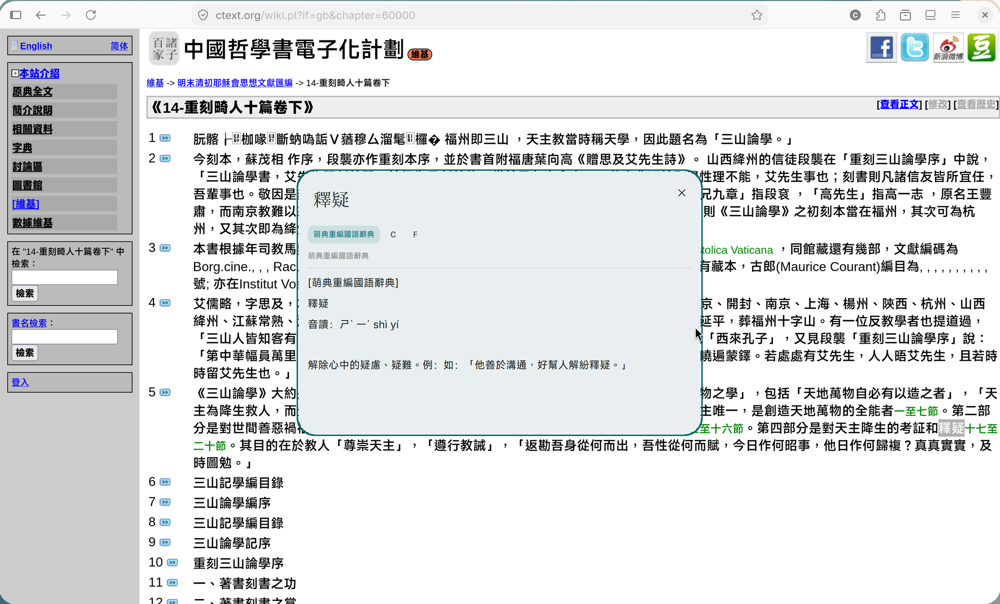

# dankLookup

Local selection dictionary lookup popup for Dank Material Shell, inspired by macOS Look Up.

Select text in any application, press `Mod+Alt+D`, and a Material 3 floating card appears with dictionary definitions — entirely offline, no network, no daemon, no clipboard monitoring. Supports Mandarin (萌典), Cantonese (words.hk), Japanese (reader.dict), and English (GCIDE / WordNet / XDICT) via a single mode-switching popup.

## Screenshot



Looking up **釋疑** (`shì yí`) on a ctext.org page. Single-mode display collapses the segmented row into a source pill alongside Copy (C) and Open-full (F) actions; the Asebi Mincho serif title differentiates CJK queries from Latin ones. Multi-mode queries (e.g. an English word with both 漢英 and 英英 results) show a segmented switcher instead of the pill.

## Features

- **Local**: no network, no daemon, no clipboard monitoring.
- **Multi-source**: offline dictionaries via `sdcv` — StarDict, GCIDE, WordNet, XDICT, Moedict.
- **Multi-mode**: configurable per-mode labels via `config.json` (漢語/漢英/英英 or any locale).
- **Configurable**: file-based source ordering via `~/.config/dank-lookup/config.json`.
- **Wayland-native**: primary selection + clipboard fallback via `wl-paste`.

## Quick start

```bash
# Install
install -Dm755 bin/dank-lookup-selection ~/.local/bin/dank-lookup-selection
install -Dm755 lib/backends/sdcv.sh ~/.local/lib/dank-lookup/backends/sdcv.sh
mkdir -p ~/.config/DankMaterialShell/plugins/dankLookup
cp plugin/* ~/.config/DankMaterialShell/plugins/dankLookup/
dms ipc call plugins reload dankLookup

# niri keybind (add to binds.kdl):
# Mod+Alt+D repeat=false { spawn "$HOME/.local/bin/dank-lookup-selection"; }

# niri window rule (add to windowrules.kdl):
# window-rule {
#     match app-id="dev.noctalia.noctalia-qs" title="Dank Lookup"
#     open-floating true
# }

# Install dictionaries (see docs/dictionary-sources.md)
```

Select text → `Mod+Alt+D` → floating lookup popup.

## Repository layout

```
dank-lookup/
├── LICENSE                 MIT
├── README.md               This file
├── CHANGELOG.md            Version history
├── plugin/                 DMS plugin (plugin.json, DankLookup.qml)
├── bin/                    Selection probe script
├── lib/backends/           Backend adapter (sdcv.sh, mock.sh)
├── tests/                  Backend fixture tests
├── docs/                   Documentation
│   ├── dictionary-sources.md
│   ├── niri-dms-install.md
│   ├── privacy.md
│   └── materialdesign3manual.md
├── examples/               Sample JSON output files
└── packaging/              Install/uninstall scripts
```

## Documentation

- `docs/dictionary-sources.md` — supported dictionaries and licenses
- `docs/niri-dms-install.md` — niri keybind and floating rule setup
- `docs/privacy.md` — privacy design principles
- `docs/materialdesign3manual.md` — UI design reference

## Backend fixtures

### CI baseline (portable — only needs GCIDE + WordNet)

```bash
DANK_LOOKUP_CONFIG=/path/to/dank-lookup/tests/configs/ci-minimal.json \
  python3 ~/.local/lib/dank-lookup/tests/run_backend_fixtures.py \
  ~/.local/lib/dank-lookup/tests/fixtures-ci-minimal
```

### Local baseline (requires full local dictionary set)

```bash
python3 ~/.local/lib/dank-lookup/tests/run_backend_fixtures.py
```

## Privacy

All processing is local. No network requests. No clipboard monitoring. See `docs/privacy.md`.

Dank Lookup currently uses a local file signal under `/tmp/dank-lookup`. It is designed for user-triggered single lookups, not high-frequency event streams.

## License

MIT (code only). Dictionary data is not bundled; see `docs/dictionary-sources.md` for compatible sources.

Some dictionaries that work locally may not be redistributable. Install dictionaries yourself and check each source's license before sharing converted StarDict files.
